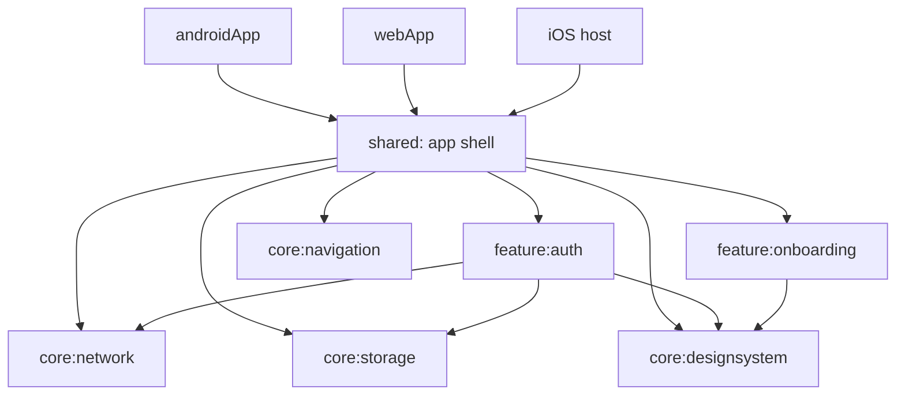

# Application architecture

The project uses separately compiled Kotlin Multiplatform modules, following the [Android architecture principles](https://developer.android.com/topic/architecture#common-principles) and [modularization patterns](https://developer.android.com/topic/modularization/patterns). Modules preserve the existing Android, iOS, JS, and Wasm targets.

## Module ownership

| Module | Responsibility | Project dependencies |
| --- | --- | --- |
| `:core:network` | Shared HTTP client, platform engines, networking DI, and HTTP tests | None |
| `:core:storage` | Suspend SecureStore API, encrypted KSafe adapter, platform singletons, and device persistence test | None |
| `:core:designsystem` | Theme, reusable components, and common UI strings | None |
| `:core:navigation` | Serializable destination contracts | None |
| `:feature:auth` | Login/register routes, ViewModel, validation, remote login, session persistence, resources, DI, and tests | `:core:designsystem`, `:core:network`, `:core:storage` |
| `:feature:onboarding` | Onboarding UI/resources, preference repository, platform DataStore factories, DI, and persistence test | `:core:designsystem` |
| `:shared` | App shell, startup state/ViewModel, application navigation graph, Koin composition root, and iOS framework | Both features and all four core modules |
| `:androidApp` | Android application/activity, system splash, and preview | `:shared`, plus onboarding/designsystem for its preview |
| `:webApp` | JS/Wasm web entry point | `:shared` |



Core modules have no feature dependencies. Feature modules have no dependencies on each other or on the app shell. Gradle dependencies enforce these boundaries. The app shell imports feature entry points and connects them through callbacks.

## Dependency injection

Each module containing definitions owns its annotated Koin module, with focused `@ComponentScan` and discovery configuration. The Koin Compiler Plugin stays enabled in network, storage, auth, onboarding, and shared. Shared directly depends on all modules that contribute definitions so the application entry point can discover them.

`shared/.../di/InitKoin.kt` remains the application composition root. `AppModule` scans app startup state holders; feature and network modules own their own bindings. A `:core:di` dependency-forwarding module is unnecessary here: there is no reusable DI implementation to extract, and putting app composition in core would reverse the intended dependency direction.

## UI and data flow

`App.kt` collects startup state with lifecycle awareness and supplies state/callbacks to `AppContent`. `startup/AppViewModel` coordinates the onboarding repository. It belongs to the app shell because it controls startup and destinations.

`HabbitNavHost` remains in shared because it assembles feature screens. Only the serializable keys live in core:navigation; their fully qualified names are unchanged so saved navigation remains compatible. Navigation 3's saveable-state and ViewModel-store decorators retain per-entry state.

`AuthRoute` resolves and collects an entry-scoped ViewModel, then passes immutable state and action callbacks to rendering functions. ViewModels receive repository interfaces through constructors, keep mutable StateFlows private, and run asynchronous work in `viewModelScope`. Repository implementations own data access. Login uses AuthRemoteDataSource and DefaultAuthRepository; registration, Google sign-in, and password reset remain unavailable.

Login and registration remain in one auth module because they share the form, validation, UI state, repository, and DI. They retain separate navigation entries and ViewModel instances. There is no independent login/register implementation boundary worth duplicating yet.

## Resources and persistence

Each feature owns its strings and illustrations under its own `src/commonMain/composeResources` directory and generated resource package. Shared owns startup messages. Core:designsystem exposes the common OK label using a public resource accessor, following [Compose Multiplatform resource configuration](https://kotlinlang.org/docs/multiplatform/compose-multiplatform-resources-usage.html#customizing-the-accessor-class-generation).

Onboarding remains persisted in DataStore with the same `habbit.preferences_pb` filename, `has_seen_onboarding` key, and platform storage locations. Successful onboarding completion is exposed only after the write succeeds. Existing loading, validation, failure, retry, and dialog behavior is preserved.

## Login and encrypted sessions

The login UI accepts a username and a nonblank password; signup retains email and password-strength validation. AuthRemoteDataSource posts JSON to [DummyJSON's user login endpoint](https://dummyjson.com/docs/users) at `https://dummyjson.com/user/login`, sending `expiresInMins=60`. It uses the shared HttpClient. The password is preserved exactly as entered; the username is trimmed.

DefaultAuthRepository validates that both response tokens are nonblank and persists all nine response fields as one serialized `auth_session` entry through SecureStore. Suspend writes complete before Success is returned. HTTP 400/401 produces an invalid-credentials result; malformed or tokenless responses never reach storage. Save failures produce a separate result, and cancellation propagates.

Core:storage owns the sole app-lifetime KSafe instance (`habbit_session`, app namespace `io.github.jcwu1.habbit`). Its adapter uses default encryption and suspend operations, with work dispatched off the UI thread. Web operations await the KSafe cache barrier before access. Features depend on the SecureStore interface; KSafe construction and platform differences stay in core:storage.

The submitted password is never persisted. Tokens stay in the data layer, outside observable UI state. Successful login shows a confirmation on the existing screen and clears the password. A signed-in destination, startup session restoration, token refresh, and logout are outside this slice.

## Verification

There are 26 host tests and one Android device integration test:

- Core:network: 3 HTTP tests.
- Feature:onboarding: 1 persistence test.
- Feature:auth: 16 validation, ViewModel, and mocked-HTTP repository tests.
- Shared: 6 startup, common/platform, and app integration tests.
- Core:storage device test: encryption metadata and typed persistence across closing/reopening KSafe.

Run:

```text
:core:network:testAndroidHostTest
:feature:onboarding:testAndroidHostTest
:feature:auth:testAndroidHostTest
:shared:testAndroidHostTest
:core:storage:connectedAndroidDeviceTest
:androidApp:assembleDebug
:webApp:compileKotlinJs
:webApp:compileKotlinWasmJs
```

Native iOS compilation requires macOS. Existing sample greeting/platform code and unrelated dependencies are outside this extraction.
